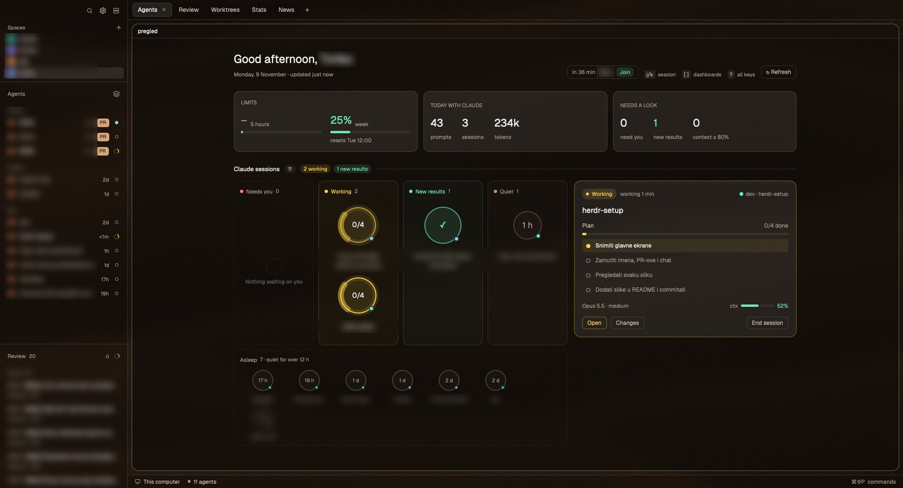
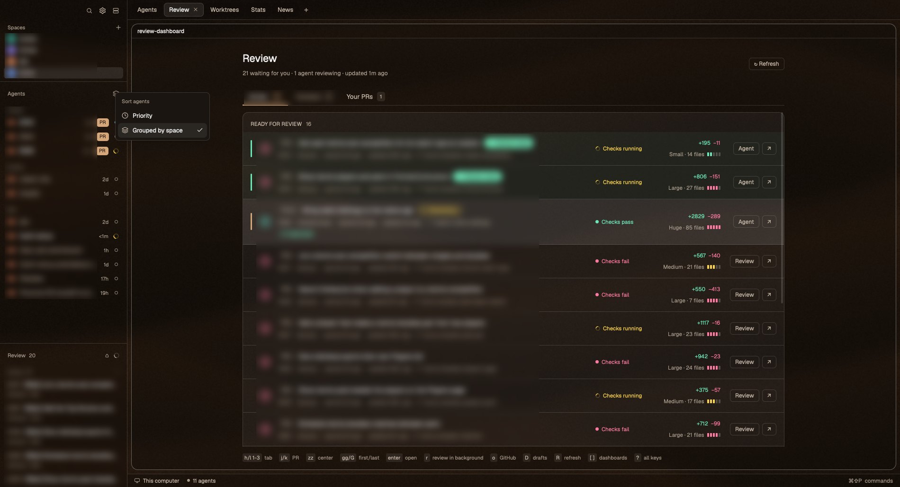
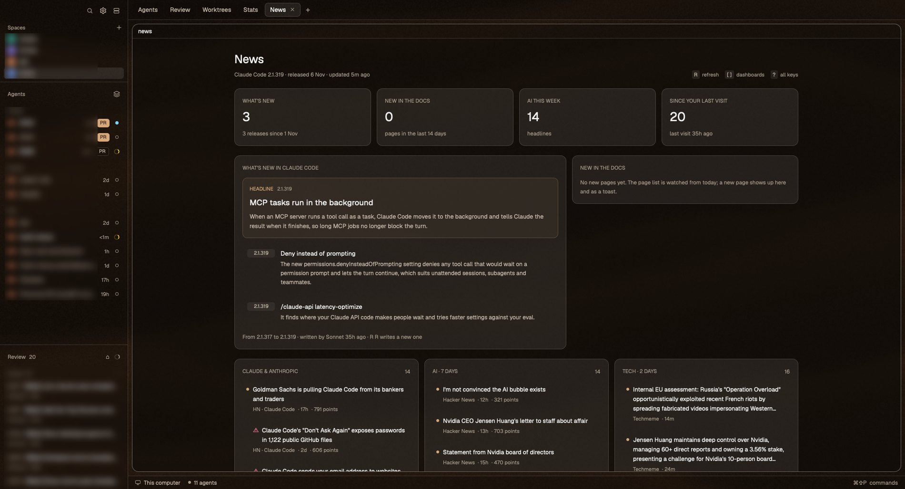
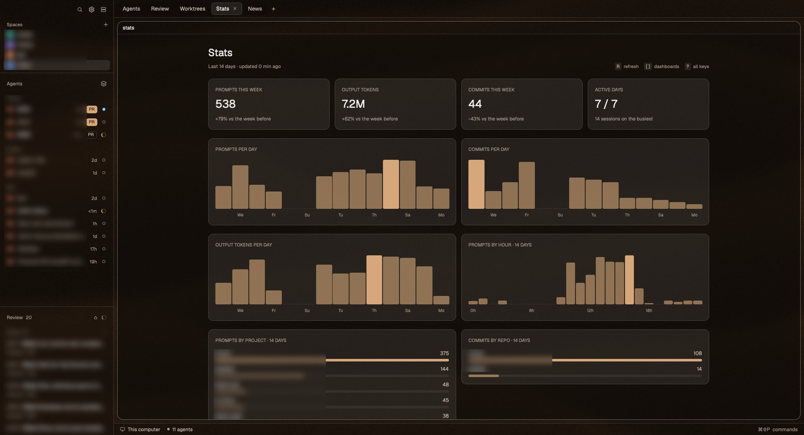

# herdr-config

My [Herdr](https://herdr.dev) setup: mods, layouts, themes and key bindings for working with Claude Code all day.



## What is in it

- **Session pane** (`claude-reader`, opened as `claude-steps`): what Claude is doing beside its terminal. The plan with each step, subagents, the files changed, the previous request, and buttons for Refs, Ask, Read, Files and Changes.
- **Reading mode** (`claude-reading`, ⌘R): the conversation drawn as a document, with a list of your prompts to jump between.
- **Changes** (`claude-changes`, ⌘⇧G): every file a session changed, in any repo, as a side-by-side diff grouped by project.
- **Aside** (⌘⇧A): ask about a session without touching it. A separate read-only `claude -p` answers, and the questions are kept per session.
- **Home space** (⌘⇧O): Agents board (`pregled`), Review (`review-dashboard`), Worktrees, Stats and News dashboards.
- **PR review** (`review-prs`, `pr-diff`): open PRs waiting for your review, a diff viewer, and Claude reviewing a PR beside it.
- **Sidebar and chrome**: `my-spaces`, `my-agents`, `my-tabs`, `my-chrome`, `my-picker`, `my-menu`, `my-pane`.
- **Layouts** `standard` and `dune`, themes, and `looks/build.py`, which draws the dune background.

## Screens

Names, repos and PR titles are blurred.

| | |
|---|---|
|  |  |
| Review: open PRs waiting for you, and Claude reviewing them in the background | News: a weekly What's new in Claude Code, new docs pages, AI and tech headlines |
|  | |
| Stats: the last 14 days of prompts, tokens and commits | |

## Install

```sh
git clone <this repo> ~/.config/herdr-app-config
```

Then link what you want into `~/.config/herdr-app/` (the mods one folder at a time, plus `layouts`, `keys.json`, `settings.json`, `themes`, `backgrounds`, `looks`). Copy `local.example.json` to `~/.config/herdr-app/local.json` and fill it in: it holds your name, repos, review skills and worktree folders, and stays out of this repo.

Some mods expect Claude Code mods from a separate setup (a plan tool, an ask mode). They work without them, with less to show.

## Notes

- Edits to a mod in a linked folder may not reload by themselves: `touch -h ~/.config/herdr-app/mods/<name>`.
- Herdr writes `gpui-kit.d.ts` and `jsconfig.json` into each mod folder. They are ignored here.
